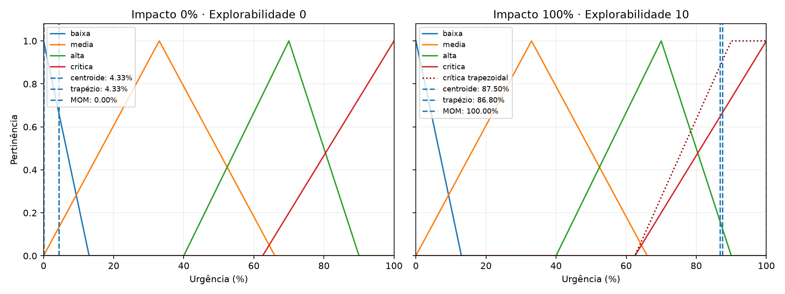
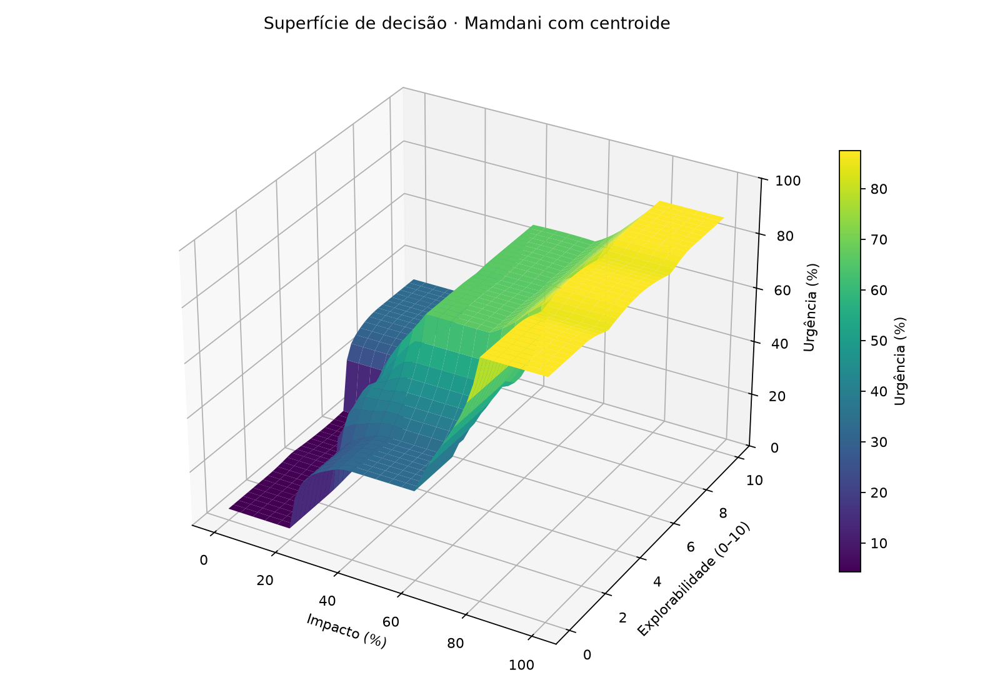

# Aula 10 — inferência Mamdani e superfície de decisão

O [Lab 01](lab01_aula10.py) implementa a matriz 3×3 de urgência de incidentes do [enunciado](lab01_aula10.txt), compara três variantes de defuzzificação e gera os gráficos. Execute na raiz do repositório:

```powershell
uv sync
uv run python -B AULA_10/lab01_aula10.py
```

As imagens geradas são [saida_extremos.png](saida_extremos.png) e [superficie_decisao.png](superficie_decisao.png).

## Parâmetros do modelo

O enunciado informa os intervalos linguísticos das entradas e os resultados de referência nos extremos, mas não os vértices exatos das funções de pertinência. Para reproduzir 4,33% e 87,5%, o código usa os parâmetros explícitos abaixo. São escolhas didáticas, não medições de risco real.

| Variável | Universo | Conjuntos |
| --- | --- | --- |
| Impacto | 0–100%, passo 1 | baixo: trap [0,0,20,40]; médio: tri [20,50,80]; alto: trap [60,80,100,100] |
| Explorabilidade | 0–10, passo 0,1 | baixa: trap [0,0,2,4]; moderada: tri [2,5,8]; alta: trap [6,8,10,10] |
| Urgência | 0–100%, passo 0,1 | baixa: tri [0,0,13]; média: tri [0,33,66]; alta: tri [40,70,90]; crítica: tri [62,5;100;100] |

As regras usam **E** (mínimo) entre as duas entradas, corte por mínimo no consequente e agregação por máximo. A variante de referência defuzzifica pelo centroide. Na abordagem A, somente urgência crítica muda para trapézio [62,5;90;100;100]. Na abordagem B, somente o método muda para MOM, mantendo todos os triângulos originais.

## Matriz de nove regras codificadas

| Impacto \ Explorabilidade | Baixa | Moderada | Alta |
| --- | --- | --- | --- |
| Baixo | R1 → baixa | R2 → baixa | R3 → média |
| Médio | R4 → média | R5 → alta | R6 → alta |
| Alto | R7 → crítica | R8 → crítica | R9 → crítica |

Cada entrada do domínio tem pelo menos um conjunto de impacto e um de explorabilidade com pertinência positiva. Logo, uma das nove regras ativa uma saída; a malha 51×41 da superfície foi calculada sem valores ausentes ou não finitos.

## Desafio dos extremos

| Impacto | Explorabilidade | Centroide triangular | A: trapézio crítico + centroide | B: triângulos + MOM |
| ---: | ---: | ---: | ---: | ---: |
| 0% | 0 | 4,333333% | 4,333333% | **0%** |
| 100% | 10 | 87,500000% | 86,798246% | **100%** |
| 50% | 5 | 66,666667% | 66,666667% | 70,000000% |
| 70% | 7 | 75,171801% | 75,203967% | 90,562018% |



Em (0,0), apenas a urgência baixa é ativada plenamente. O centroide do triângulo [0,0,13] é `(0 + 0 + 13)/3 = 4,333333`, embora o máximo de pertinência esteja em 0. Em (100,10), apenas a crítica é ativada plenamente; o centroide de [62,5;100;100] é `(62,5 + 100 + 100)/3 = 87,5`. O centroide é o centro de massa de uma área com largura, portanto fica dentro dessa área e não na borda do universo.

O trapézio crítico forma um platô entre 90 e 100, mas mantém área à esquerda de 100. Seu centroide é **86,798246%**, ligeiramente menor que o do triângulo deste experimento; mudar para trapézio não garante 100%. A ponta baixa continua 4,333333% porque seu conjunto não foi alterado. Já o MOM calcula a média dos pontos onde a saída agregada atinge pertinência máxima. Os triângulos de borda atingem esse máximo somente em 0 e 100; por isso MOM devolve exatamente os dois extremos.

Para examinar a suavidade, variou-se o impacto de 0 a 100 em passos de 0,5, com explorabilidade fixa em 5. A maior mudança entre amostras vizinhas foi **6,853800 pontos percentuais** para centroide e trapézio, contra **50,132171 pontos percentuais** para MOM. MOM pode saltar quando a região de maior ativação muda de um termo para outro; em (70,7), por exemplo, ele já produz 90,562018%, enquanto o centroide produz 75,171801%. A malha evidencia o risco de uma decisão brusca, sem provar um limite global para todos os pontos.

**Conclusão:** entre as abordagens testadas, o centroide preserva melhor as transições, e MOM é a única que crava 0% e 100% nos casos extremos. **Nenhuma das duas modificações isoladas combina as duas propriedades.** Para um controlador que precisa de transições graduais, recomenda-se o centroide e uma calibração explícita da escala de saída caso 0% e 100% sejam requisitos formais; trocar só a função crítica por um trapézio não resolve os extremos.

## Superfície de decisão 3D



A superfície usa o modelo triangular com centroide e contém **2.091 pontos**: impacto 0–100 em 51 valores e explorabilidade 0–10 em 41 valores. Na malha, a urgência variou de **4,333333%** a **87,500000%**. A região de impacto baixo e explorabilidade baixa forma um patamar próximo de 4,33%. A elevação de explorabilidade desloca gradualmente a saída para urgência média ou alta conforme as regras da linha correspondente. Impacto alto mantém a urgência crítica em toda a faixa de explorabilidade, criando o patamar superior. As faixas inclinadas entre esses patamares representam sobreposição dos conjuntos e ativação simultânea de regras.

Não há buracos na malha nem fronteiras abruptas visíveis no gráfico. Como as funções de pertinência são contínuas, há cobertura positiva das entradas e a área agregada nunca desaparece, o centroide varia continuamente neste modelo. A figura amostrada ilustra essa propriedade; sozinha não é uma prova matemática de continuidade nem de adequação do índice a incidentes reais.
